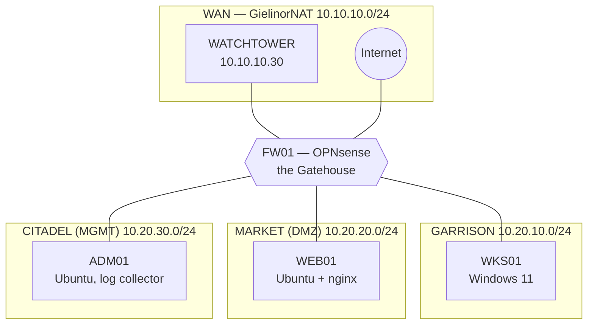

# Network Segmentation Labs — *The Wrkstation Chronicles: The Gatehouse*

Take a flat, wide-open network and turn it into **four defended zones** behind an **OPNsense** firewall — then prove the walls hold by playing the intruder yourself. Eight story-driven modules, built entirely from free software in VirtualBox, with no GNS3 and no Packet Tracer.

Part of **Project AegisForge** → **Network Engineer path** → *Phase 1: Secure Network Design & Hardening* → the **Secure Segmented Network** project.

> **Requires:** [FW01](../../Lab%20Foundations/VM%20Cards/FW01.md), [WEB01](../../Lab%20Foundations/VM%20Cards/WEB01.md) and [ADM01](../../Lab%20Foundations/VM%20Cards/ADM01.md) (built in this lab); [WKS01](../../Lab%20Foundations/VM%20Cards/WKS01.md) in its **minimal** state (a linked clone is recommended); [WATCHTOWER](../../Lab%20Foundations/VM%20Cards/WATCHTOWER.md); the shared `GielinorNAT` network ([setup](../../Lab%20Foundations/VirtualBox%20and%20GielinorNAT.md)). **DC01 and SRV01 are not needed.**
> **Leaves behind:** WKS01 on `realm-garrison` using DHCP from FW01, a firewall with a complete four-zone policy, `00-flat-baseline` snapshots on every VM. Cleaning-up steps at the end of the Guide return WKS01 to the flat realm.
> **Reset:** restore every VM to `00-flat-baseline`.
> **Never done the earlier labs?** Start at [Lab Foundations](../../Lab%20Foundations/README.md).

> **Written for network engineers who have never touched these tools.** You already understand subnets, routing, and ACLs. This lab does *not* assume you know OPNsense, VirtualBox internal networks, Ubuntu, nginx, or Windows PowerShell. Every click is described, every term is explained the first time it appears, and there is a primer for the concepts behind them.

---

## The story

For years the Realm ran on one big open field. The market stalls, the garrison barracks, and the Citadel where the administrators keep the keys all stood on the same flat ground, with nothing between them. Then a raider walked in through the front stall — a compromised public web server — and strolled straight up to the Citadel gates.

You are the new **Gatekeeper**. Build the walls, open exactly the gates that should be open, and keep watch. Then put on the raider's boots and try to climb your own walls.

## What you'll learn

1. See what a **flat network** really costs: from one compromised web server, how far can an intruder get?
2. **Design zones and a trust model** on paper before touching a firewall (the part most people skip).
3. Build a **default-deny rule base** per zone, with aliases, correct rule order, and meaningful logging.
4. **Publish a service safely** from a DMZ (destination NAT + the matching rule) — and *only* that service.
5. **Prove** the policy works: test matrices, the live firewall log, firewall states, and packet captures that show *block* versus *reject*.
6. **Harden the firewall itself**: move management to a dedicated zone, use a jump host, and lock the web GUI and SSH.
7. **Control egress and DNS**: allow-list what a server may fetch, stop command-and-control callbacks, and block bad domains at the resolver.
8. **Watch and respond**: ship firewall logs to a central collector, run an IDS (Suricata) on the DMZ, then run an *assume-breach* capstone and write the assessment report.

## The realm at a glance

| Zone | Network | What lives there | Trust |
|---|---|---|---|
| **WAN** — *the Wilderness* | `10.10.10.0/24` (the shared `GielinorNAT`; FW01's WAN is the static `10.10.10.5`) + the real internet | WATCHTOWER plays "the outside world" | None |
| **GARRISON** (LAN) | `10.20.10.0/24` | WKS01, the users' workstation | Medium |
| **MARKET** (DMZ) | `10.20.20.0/24` | WEB01, the public web server | Low — assume it will be attacked |
| **CITADEL** (MGMT) | `10.20.30.0/24` | ADM01, the admin host and log collector | High — reachable by almost nothing |

## You'll need

| | Minimum |
|---|---|
| **Host PC** | 16 GB RAM is comfortable (about 11 GB for all five VMs at once), 4+ CPU cores, ~90 GB free disk |
| **Software** | VirtualBox 7.x, and the free ISOs listed in the Environment Setup |
| **Existing lab pieces** | `GielinorNAT` (the VirtualBox NAT Network), **WKS01** (Windows 11, from the Windows labs), **WATCHTOWER** (Ubuntu, from the Wireshark lab — it plays "the outside world") |
| **New VMs** | **FW01** (OPNsense), **WEB01** (Ubuntu Server), **ADM01** (Ubuntu Server) |
| **Time** | 8–10 hours total, plus about 1.5 hours of one-off setup |
| **Cost** | Free |

**Short on RAM?** WATCHTOWER can stay powered off for Modules 1–3, 5 and 6; you only need it for the "outside" tests in Modules 4, 7 and 8. See *RAM budget* in the setup guide.

**Never used any of this before?** Read **Segmentation Lab Primer.md** first. It is a 20-minute read that explains firewalls, zones, VirtualBox networking, and just enough Linux and Windows to follow along.

## Files

| File | What it is |
|---|---|
| **Segmentation Lab Primer.md** | Concepts and tools explained from scratch — read first if OPNsense, VirtualBox or Linux are new to you |
| **Segmentation Lab Environment Setup.md** | Build FW01, WEB01 and ADM01, connect the zones, verify (start here once you've read the primer) |
| **Segmentation Lab Guide.md** | The lab — eight modules |
| **Segmentation Lab Answer Key.md** | Check your work *after* you've tried |
| **Segmentation Lab Troubleshooting.md** | "It doesn't work" fixes, ordered by how often they happen |
| `setup-segmentation-host.sh` | WEB01 / ADM01: static IP, nginx services, log receiver (`--role web` or `--role adm`) |
| `Setup-SegmentationLab-WKS01.ps1` | WKS01: a test "canary" service on port 8080 and ping allowed (supports `-Remove`) |
| `segtest.sh` / `Test-Segmentation.ps1` | The **test matrix**: tries each connection and tells you PASS/FAIL against your policy (Linux / Windows) |
| `attack-sim.sh` | The *assume-breach* simulator for Module 8 — runs only on WEB01, only plain connection attempts |
| `topology.png` / `topology.svg` | The network diagram |
| `SHA256SUMS` | Checksums so you can verify the scripts weren't altered |

## Safety — please read

- **Isolated lab VMs only.** The starting state is *deliberately* wide open, and `attack-sim.sh` behaves like an intruder. Keep every VM on the VirtualBox networks named in the setup guide. Never bridge any of them to your home or work network.
- **Never point these tools at a network you don't own.** `attack-sim.sh` refuses to run anywhere except WEB01, and every target in the test scripts is a lab address.
- **Read every script before running it with administrator rights.** They are short and commented.
- **Take snapshots.** Firewall mistakes can lock you out of your own firewall. Module 6 (management hardening) is the dangerous one; the guide tells you when to snapshot and how to recover from the console.
- Verify downloads: `sha256sum -c SHA256SUMS` (Linux) or `Get-FileHash <file>` (Windows) and compare.
- This is a *defensive* lab. The capstone has you test your own walls the way an intruder would, using plain connection attempts and one stock `nmap` scan. It does not teach exploitation.

## Version note — OPNsense changes its menus

OPNsense is mid-way through moving its configuration screens to a new framework, and menu names shift between releases. This lab was written against **OPNsense Community Edition 26.7** (the current series when it was written). Where the menu name or layout differs in older releases, the guide tells you what to look for. If a field has moved, the **search box at the top of the OPNsense web GUI** finds almost any setting by name.

## Versioning

Current: **v1.0.0**. Scripts, guides, and answer key move together.

## Feedback

Found a rough edge or a better way to explain a step? Open an issue on the repo.
