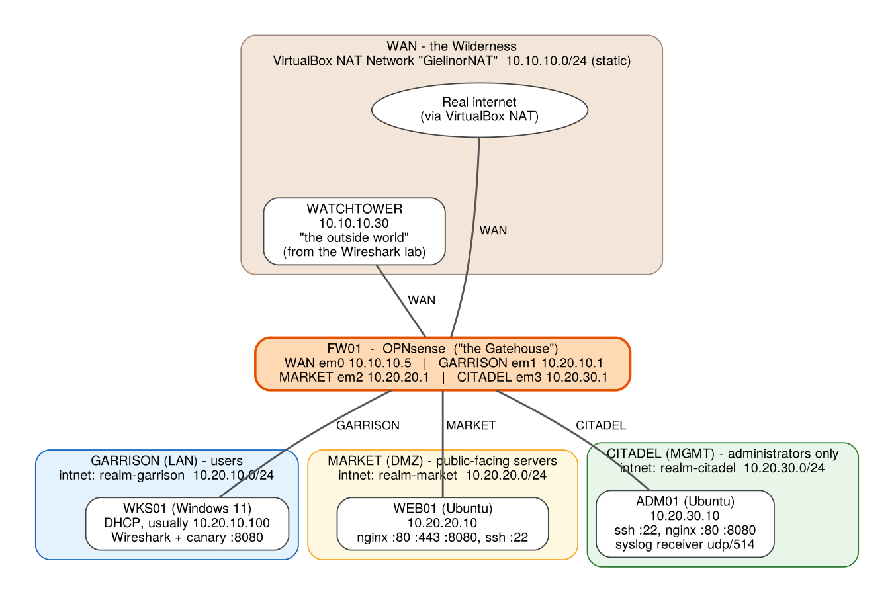

# The Gatehouse — Environment Setup

Plan on **about 90 minutes** the first time. At the end you will have five virtual machines on four virtual networks, a firewall that currently lets *everything* through (on purpose — that's Module 1's starting point), and a snapshot to roll back to.

> **New to OPNsense, VirtualBox internal networks, or Ubuntu?** Skim **Segmentation Lab Primer.md** first (20 minutes). This guide assumes you've read at least sections 1 and 3.

> ⚠️ **Isolated lab only.** Everything here is intentionally weak at the start. Never bridge any of these VMs onto your home or work network and never expose them to the internet.

---

## What you're building



| VM | Role | OS | RAM | Disk | Network adapter(s) |
|---|---|---|---|---|---|
| **FW01** *(new)* | The firewall — "the Gatehouse" | OPNsense (FreeBSD) | 2 GB (4 GB if you'll run Suricata in Module 8) | 12 GB | **4 adapters**, see below |
| **WEB01** *(new)* | Public web server in the DMZ | Ubuntu Server 24.04 | 1 GB | 10 GB | `realm-market` |
| **ADM01** *(new)* | Admin / jump host and log collector | Ubuntu Server 24.04 | 1 GB | 10 GB | `realm-citadel` |
| **WKS01** *(existing; a linked clone is recommended)* | Users' workstation — your daily driver | Windows 11 | 4 GB | existing | `realm-garrison` |
| **WATCHTOWER** *(existing)* | Plays "the outside world" | Ubuntu Server (from the Wireshark lab) | 2 GB | existing | `GielinorNAT` (unchanged) |

**RAM budget:** all five at once ≈ 10 GB for the guests plus your host. On a 16 GB PC that works. On 8–12 GB, leave WATCHTOWER off until you need it (Modules 4, 7, 8) and keep DC01 (from the Windows lab) powered **off** — this lab doesn't use it.

### Address plan

| Zone | Subnet | Firewall address | Hosts |
|---|---|---|---|
| WAN | `10.10.10.0/24` (`GielinorNAT`) | `10.10.10.5` (static) | WATCHTOWER `10.10.10.30` |
| GARRISON | `10.20.10.0/24` | `10.20.10.1` | WKS01 by DHCP (`10.20.10.100`–`199`) |
| MARKET | `10.20.20.0/24` | `10.20.20.1` | WEB01 `10.20.20.10` |
| CITADEL | `10.20.30.0/24` | `10.20.30.1` | ADM01 `10.20.30.10` |

The three `10.20.x.0/24` networks are carved from a single `10.20.0.0/16` block. That makes it easy to write one rule that means "anywhere inside the realm". You'll see that block named `NET_REALM` later.

---

## Step 0 — Downloads

| What | Where | Notes |
|---|---|---|
| **OPNsense** | <https://opnsense.org/download/> | Architecture **amd64**, image type **dvd**, pick any mirror. You get a file ending `.iso.bz2`. |
| **Ubuntu Server 24.04 LTS** | <https://ubuntu.com/download/server> | The ISO (not the desktop image). You probably already have this from the Wireshark lab. |
| **7-Zip** (to unpack `.bz2` on Windows) | <https://www.7-zip.org/> | Right-click the `.bz2` → *7-Zip → Extract Here* gives you the `.iso`. |

**Verify the OPNsense download** (recommended): the download page links a checksum file. In PowerShell:

```powershell
Get-FileHash .\OPNsense-*-dvd-amd64.iso.bz2 -Algorithm SHA256
```

Compare the hash with the one on the site. A mismatch means a corrupted download — fetch it again.

---

## Step 1 — Check the WAN network (`GielinorNAT`)

You already have this from the earlier labs, but confirm two things:

1. VirtualBox → **File → Tools → Network Manager → NAT Networks** (in older versions: *File → Preferences → Network*).
2. Select **GielinorNAT**. Confirm the IPv4 prefix is **`10.10.10.0/24`** and **Enable DHCP is un-ticked**. That's how the earlier labs built it: every VM has a fixed address. FW01 will therefore get a **static** WAN address, `10.10.10.5`, gateway `10.10.10.1`. (Never built `GielinorNAT`? See *Lab Foundations → VirtualBox and GielinorNAT.md* and create it first.)

**You do not create the three zone networks in advance.** An *Internal Network* springs into existence the moment you type its name into an adapter. Just be careful to type the names **exactly**, because `realm-market` and `realm-Market` are two different switches.

---

## Step 2 — Create the FW01 virtual machine

1. VirtualBox → **New**.
   - **Name:** `FW01`
   - **ISO Image:** select the unpacked OPNsense `.iso`
   - Tick **Skip Unattended Installation**
   - **Type:** `BSD` — **Version:** `FreeBSD (64-bit)`
2. **Hardware:** Memory **2048 MB** (use 4096 if you can spare it), Processors **2**. Leave *Enable EFI* **un**ticked.
3. **Virtual Hard Disk:** create a new disk, **12 GB**, VDI, dynamically allocated.
4. Finish, then select FW01 → **Settings → Network**. Configure **all four adapters**:

| Adapter | Enable | Attached to | Name | Advanced → Adapter Type |
|---|---|---|---|---|
| **1** | ✔ | **NAT Network** | `GielinorNAT` | Intel PRO/1000 MT Desktop (82540EM) |
| **2** | ✔ | **Internal Network** | `realm-garrison` | Intel PRO/1000 MT Desktop (82540EM) |
| **3** | ✔ | **Internal Network** | `realm-market` | Intel PRO/1000 MT Desktop (82540EM) |
| **4** | ✔ | **Internal Network** | `realm-citadel` | Intel PRO/1000 MT Desktop (82540EM) |

(Click **Advanced** under each adapter to reach *Adapter Type* and the MAC address.)

5. **Write down the MAC address of each adapter** (*Advanced → MAC Address*, or just the last 4 characters). In Step 4 you'll use them to be certain which firewall interface is which.

> **Why four adapters?** Each adapter is one leg of the firewall: one to the Wilderness (WAN), one into each of the three zones. A firewall can only enforce rules between networks it is physically (here, virtually) *connected to*.

---

## Step 3 — Install OPNsense

1. Start FW01. A boot menu counts down — let it run. After a minute of boot messages you'll see a `login:` prompt. This is the **live installer image**, not yet an installed system.
2. At `login:` type `installer`, press Enter. At *Password:* type `opnsense`, press Enter.
3. Work through the installer. The screens vary a little between versions, but the path is:
   - **Keymap:** accept the default (or pick yours).
   - **Install (UFS)** — the simple option (ZFS also works, but UFS asks fewer questions). Use VirtualBox snapshots for rollback.
   - **Disk:** choose the single virtual disk (it'll look like `da0` or `ada0`, "VBOX HARDDISK"). Confirm erasing it — it's a brand-new empty virtual disk.
   - **Root Password:** choose one you will remember and **write it down**. This is the firewall's administrator password.
   - **Complete Install**, then let it reboot.
4. **Eject the ISO** so it doesn't boot the installer again: in the VM window, *Devices → Optical Drives → Remove disk from virtual drive* (tick *Force Unmount* if asked).

> **Back at a `login:` prompt that mentions `installer`?** You booted the ISO again. Power the VM off, remove the disk from the virtual optical drive, and start again. The installed system shows a **numbered menu** (options 0–13), not a bare login.

When the firewall finishes booting you'll see the console menu with the system's default addresses shown above it (`LAN (em1) -> v4: 192.168.1.1/24`). We're about to replace those.

---

## Step 4 — First-time console configuration

Everything in this step is typed on the FW01 **VM console** (its own screen). There's no GUI yet.

### 4a — Assign the interfaces

OPNsense named the network cards `em0`–`em3` (the names may differ — e.g. `igc0` — use whatever the menu lists). It auto-assigned only the first two, so we must assign all four deliberately.

1. At the menu, type **`1`** (*Assign interfaces*), Enter.
2. *Do you want to configure LAGGs now?* → **`n`**
3. *Do you want to configure VLANs now?* → **`n`**
4. The screen lists the valid interfaces with their **MAC addresses**. **Compare them with the MAC addresses you wrote down** to confirm the order. Expect:

| OPNsense asks for | Type | VirtualBox adapter | It's the… |
|---|---|---|---|
| WAN interface | `em0` | Adapter 1 | `GielinorNAT` side |
| LAN interface | `em1` | Adapter 2 | `realm-garrison` |
| Optional interface 1 | `em2` | Adapter 3 | `realm-market` |
| Optional interface 2 | `em3` | Adapter 4 | `realm-citadel` |
| Optional interface 3 | *(just press Enter)* | | |

5. Confirm with **`y`**. The firewall reloads and returns to the menu, now showing four interfaces.

> **MAC addresses don't match the order?** Trust the MACs, not the names. Assign whichever `emX` has the MAC of *Adapter 1* as WAN, and so on.

### 4b — Set the addresses

Choose **`2`** (*Set interface IP address*) once per interface. Answers marked ↵ mean "just press Enter".

**GARRISON (shown as LAN)** — select its number from the list, then:

| Question | Answer |
|---|---|
| Configure IPv4 address via DHCP? | `n` |
| New IPv4 address | `10.20.10.1` |
| IPv4 subnet bit count | `24` |
| Upstream gateway (for a LAN) | ↵ (none) |
| IPv6 via WAN tracking? | `n` |
| IPv6 via DHCP6? | `n` |
| New IPv6 address | ↵ (none) |
| Enable DHCP server on LAN? | `y` |
| Start of client address range | `10.20.10.100` |
| End of client address range | `10.20.10.199` |
| Change the web GUI to HTTP? | `n` |
| Generate a new self-signed certificate? | `n` |
| Restore web GUI access defaults? | `n` |

**MARKET (shown as OPT1)** — IPv4 DHCP `n`, address `10.20.20.1`, bits `24`, no gateway, IPv6 `n`/`n`/↵, DHCP server **`n`**.

**CITADEL (shown as OPT2)** — IPv4 DHCP `n`, address `10.20.30.1`, bits `24`, no gateway, IPv6 `n`/`n`/↵, DHCP server **`n`**.

**WAN** — it needs a **static** address, because `GielinorNAT` has no DHCP server. Select the WAN interface, then:

| Question | Answer |
|---|---|
| Configure IPv4 address via DHCP? | `n` |
| New IPv4 address | `10.10.10.5` |
| IPv4 subnet bit count | `24` |
| Upstream gateway | `10.10.10.1` |
| Use the gateway as the name server? | `n` |
| IPv4 name server (if asked) | `1.1.1.1` |
| IPv6 via DHCP6? / WAN tracking? | `n` |
| New IPv6 address | ↵ (none) |
| Change the web GUI to HTTP? / new certificate? / restore defaults? | `n` |

If the prompt wording differs slightly in your version, the intent is: static IPv4 `10.10.10.5/24`, gateway `10.10.10.1`, no IPv6.

The servers in Market and Citadel use fixed addresses; only the Garrison hands out leases.

### 4c — Note the WAN address

The menu should now show `WAN (em0) -> v4: 10.10.10.5/24`. That's the "front gate" address you'll aim at from WATCHTOWER in Module 4. It's fixed, so it won't change between sessions.

> **WAN shows no address?** See *Troubleshooting → "FW01 has no WAN address"* before continuing.

---

## Step 5 — Prepare WKS01 *(while it still has internet)*

WKS01 is about to move onto a network with no internet until the firewall is configured, so grab what it needs **first**.

**Which WKS01?** You only need the **minimal** WKS01 (Windows 11 installed, not domain-joined). See [WKS01's card](../../Lab%20Foundations/VM%20Cards/WKS01.md). If you don't have one yet, build it from that card now.

Strongly recommended: **don't change your original.** In VirtualBox right-click WKS01 → **Clone** → **Linked clone**, name it `WKS01-gatehouse`, and use the clone for this lab. Your flat-realm WKS01 (static `10.10.10.20`, domain-joined) stays exactly as it was. If you'd rather reuse the original, that works too; the *Cleaning up* section shows how to restore it.

1. Make sure the WKS01 you're using is on `GielinorNAT` and online. **Power off DC01** if it's running — this lab doesn't use it.
2. On WKS01, download the lab files: open
   `https://github.com/mtadevich94/AegisForge-Labs/archive/refs/heads/main.zip`
   in a browser, then extract the ZIP (right-click → *Extract All*). The files live in
   `AegisForge-Labs-main\labs\Networking\Network Segmentation Labs\`.
3. Open that folder, read `Setup-SegmentationLab-WKS01.ps1` in Notepad (always read a script before you run it as an administrator — it's short), then run it **as administrator**:

```powershell
cd "C:\path\to\Network Segmentation Labs"
powershell -ExecutionPolicy Bypass -File .\Setup-SegmentationLab-WKS01.ps1
```

It should finish with `canary :8080  listening` in green. What it does: opens TCP 8080 and ping in Windows' own firewall, and starts a tiny web listener (the **canary**) so the other zones have something real to try — and fail — to reach.

4. **Switch WKS01 to DHCP.** In the flat realm it has a fixed address (`10.10.10.20`, DNS `10.10.10.10`). In the Gatehouse the firewall hands out addresses, so release the fixed settings. In PowerShell as administrator (check the adapter name with `Get-NetAdapter`; it's usually `Ethernet`):

```powershell
$if="Ethernet"
Remove-NetRoute -InterfaceAlias $if -DestinationPrefix 0.0.0.0/0 -Confirm:$false -ErrorAction SilentlyContinue
Remove-NetIPAddress -InterfaceAlias $if -AddressFamily IPv4 -Confirm:$false -ErrorAction SilentlyContinue
Set-NetIPInterface -InterfaceAlias $if -Dhcp Enabled
Set-DnsClientServerAddress -InterfaceAlias $if -ResetServerAddresses
```

   (If this WKS01 never had a static address, those commands are harmless.)

5. **Shut WKS01 down** (Start → Power → Shut down), then take a **VirtualBox snapshot** named `pre-gatehouse-lab`.
6. In VirtualBox: WKS01 → **Settings → Network → Adapter 1** → change **Attached to** to **Internal Network**, name **`realm-garrison`**. Keep the adapter type as it is.
7. Start WKS01 and log in. If it was ever domain-joined, Windows signs you in with **cached credentials** because DC01 is unreachable — that can take a minute longer. This is expected.
8. Open PowerShell and run `ipconfig`. You should see an address in **`10.20.10.100`–`199`**, a gateway of **`10.20.10.1`**, and DNS of **`10.20.10.1`**. If you see `169.254.x.x`, DHCP didn't answer — see Troubleshooting.

---

## Step 6 — First login to the firewall web GUI

1. On **WKS01**, open a browser and go to **`https://10.20.10.1`**.
2. The browser warns *"Your connection isn't private"*. That's expected: the firewall made its own **self-signed certificate** (no public authority vouches for it). Click **Advanced → Continue to 10.20.10.1**. (On your own network you'd install a proper certificate; for a lab it's fine.)
3. Log in: **Username `root`**, **Password** = the one you chose in Step 3.
4. The **setup wizard** starts. Work through it:

| Wizard screen | Setting | Value |
|---|---|---|
| General information | Hostname | `FW01` |
| | Domain | `gielinor.local` |
| | Primary DNS server | `1.1.1.1` |
| | Secondary DNS server | `9.9.9.9` |
| | *Override DNS* | **un**tick (so these two servers are always used) |
| Time server | Timezone | yours |
| Configure WAN | Type | `Static` |
| | IPv4 address / gateway | `10.10.10.5` / `10.10.10.1` (add the gateway if asked, upstream gateway name `GW_WAN`) |
| | **Block RFC1918 Private Networks** | **UNTICK** ⚠ |
| | **Block bogon networks** | **UNTICK** ⚠ |
| Configure LAN | IP / Subnet | `10.20.10.1` / `24` (already filled in) |
| Set root password | | Re-enter the same password, or choose a new one |

> ⚠ **The two WAN checkboxes matter.** "Block private networks" drops anything arriving on the WAN from a private (RFC 1918) address. On a real internet connection that is a good thing. Here, the WAN side *is* a private network (`10.10.10.0/24`), including WATCHTOWER — so left ticked, your WAN would silently refuse every test from "the outside". Untick both.

5. Click **Next/Reload** until the wizard finishes and the dashboard appears.

---

## Step 7 — Name the interfaces and enable the zones

Give each interface a meaningful **description** — it's what appears in menus and rules.

1. **Interfaces → [LAN]**
   - **Description:** `GARRISON`
   - **IPv6 Configuration Type:** `None`
   - **Save**, then **Apply changes**.
2. **Interfaces → [OPT1]**
   - **Enable interface:** ✔
   - **Description:** `MARKET`
   - **IPv4 Configuration Type:** `Static IPv4`; **IPv4 address** `10.20.20.1` / **24**
   - **IPv6 Configuration Type:** `None`
   - **Save**, **Apply changes**.
3. **Interfaces → [OPT2]**
   - **Enable interface:** ✔, **Description:** `CITADEL`
   - **Static IPv4**, address `10.20.30.1` / **24**, IPv6 `None`
   - **Save**, **Apply changes**.
4. **Interfaces → [WAN]**: confirm **Block private networks** and **Block bogon networks** are both **unticked** (the wizard should have done it; check anyway), set **IPv6 Configuration Type** to `None`, **Save**, **Apply changes**.
5. **Interfaces → Overview** — all four interfaces should read **up**, with the addresses from the address plan.

> **Why `IPv6 = None` everywhere?** IPv6 is a real topic (the Network path covers it later) but a second address family doubles everything you'd have to firewall and test. This lab stays IPv4-only so the lessons stay focused.

---

## Step 8 — The temporary "flat realm" rules

A freshly built zone with no rules blocks everything (default deny). For setup we need all three zones to reach the internet and each other, so we add one **deliberately terrible** rule per zone. These are **your Module 1 starting point** — and Module 3 deletes them.

First, look at what's already there: **Firewall → Rules → GARRISON**. The installer created **"Default allow LAN to any"** rules (one for IPv4, one for IPv6). Leave them for now.

Now create the temporary rules on **MARKET** and **CITADEL**. For each of those two interfaces:

1. **Firewall → Rules → *MARKET*** (pick the interface), click **+ Add**.
2. Fill in:

| Field | Value |
|---|---|
| Action | **Pass** |
| Interface | MARKET *(or CITADEL)* |
| Direction | `in` |
| TCP/IP Version | `IPv4` |
| Protocol | `any` |
| Source | `any` |
| Destination | `any` |
| Description | `TEMP flat realm - removed in Module 3` |

3. **Save**, then **Apply changes**. Repeat for **CITADEL**.

> **This is the mistake we're going to study.** One "allow any any" rule per zone turns four separate networks into one big one. It is also exactly what many real networks look like.

---

## Step 9 — Build WEB01 (Market / DMZ)

1. VirtualBox → **New**: Name `WEB01`, ISO = the Ubuntu Server ISO, **Skip Unattended Installation**, Type `Linux`, Version `Ubuntu (64-bit)`. Memory **1024 MB**, 1 CPU, disk **10 GB**.
2. **Settings → Network → Adapter 1:** **Internal Network**, name **`realm-market`**; *Advanced → Adapter Type:* Intel PRO/1000 MT Desktop.
3. Start the VM and install Ubuntu Server. Key screens:
   - **Network connections:** there's no DHCP in this zone, so the installer shows the interface without an address. Select it → **Edit IPv4** → **Manual** and enter:
     - Subnet: `10.20.20.0/24`  Address: `10.20.20.10`  Gateway: `10.20.20.1`
     - Name servers: `10.20.20.1`
     - Save. (Thanks to the temporary flat rule, the installer will now reach the internet through your firewall.)
   - **Mirror/proxy:** accept the defaults. **Storage:** accept the defaults.
   - **Profile:** your name `Gatekeeper`; server name `web01`; username `gatekeeper`; a password you'll remember.
   - Tick **Install OpenSSH server**. Skip all featured snaps.
4. When it says to reboot, press Enter after it ejects the install media.
5. Log in at the console as `gatekeeper`. Run:

```bash
sudo apt-get update && sudo apt-get install -y git
git clone https://github.com/mtadevich94/AegisForge-Labs.git
cd "AegisForge-Labs/labs/Networking/Network Segmentation Labs"
less setup-segmentation-host.sh        # read it first; press q to quit
sudo bash setup-segmentation-host.sh --role web
```

The script re-asserts the static address, checks it can reach the firewall and the internet, installs nginx (a web server) and a few tools, creates the demo web pages, and ends with a self-test. You want to see `web01 is ready in the Market (DMZ) zone.`

> **Why does the script test the internet first?** Because the most common setup mistake is a missing "flat realm" rule or a wrong network name. Failing early with a clear message is kinder than failing halfway through an `apt` download.

---

## Step 10 — Build ADM01 (Citadel / MGMT)

Repeat Step 9 with these differences:

| Setting | WEB01 | **ADM01** |
|---|---|---|
| VM name / server name | `web01` | **`adm01`** |
| Adapter 1 network | `realm-market` | **`realm-citadel`** |
| Installer static address | `10.20.20.10` | **`10.20.30.10`** |
| Gateway and DNS | `10.20.20.1` | **`10.20.30.1`** |
| Setup script | `--role web` | **`--role adm`** |

The final message should be `adm01 is ready in the Citadel (MGMT) zone.`

---

## Step 11 — Confirm WATCHTOWER

Power on **WATCHTOWER** (the Ubuntu server from the Wireshark lab) if it isn't running. It must still be on `GielinorNAT` at `10.10.10.30`. If you never built it, follow the *Packet Watch* lab's setup first — it takes about 15 minutes and is the lab's "outside world".

---

## Step 12 — Verify everything talks (the flat realm works)

Run these checks. Because the temporary rules allow everything, **every one of them should succeed**.

**On WEB01** (type at its console, or `ssh gatekeeper@10.20.20.10` from WKS01's PowerShell):

```bash
ip -br a                                  # 10.20.20.10/24 on the interface
ping -c 2 10.20.20.1                      # the firewall answers
nslookup example.com 10.20.20.1           # the firewall's DNS resolver answers
curl -sI http://10.20.30.10 | head -1     # HTTP/1.1 200 OK  (Citadel reachable — the flat realm!)
curl -sI http://10.10.10.30 | head -1     # an HTTP response from WATCHTOWER
```

**On WKS01** (PowerShell):

```powershell
ipconfig                                  # 10.20.10.1xx, gateway & DNS 10.20.10.1
nslookup example.com                      # answers via 10.20.10.1
Test-NetConnection 10.20.20.10 -Port 80   # TcpTestSucceeded : True
```

**From a browser on WKS01:** `http://10.20.20.10` shows "The Marketplace", and `http://10.20.20.10:8080` shows the **"Admin Panel"** — hold that thought. The admin panel is reachable from the Garrison because nothing is stopping it.

| Check | ✔ |
|---|---|
| FW01 interfaces all *up* with correct addresses | ☐ |
| WKS01 got a `10.20.10.1xx` address by DHCP | ☐ |
| WEB01 reaches the firewall, DNS, and WATCHTOWER | ☐ |
| WEB01 can reach ADM01 (this is the problem!) | ☐ |
| ADM01 reaches the firewall and internet | ☐ |
| WKS01 can browse to WEB01 | ☐ |

---

## Step 13 — Snapshots (do this now)

Power off the VMs cleanly (**ADM01, WEB01, WKS01 first, FW01 last**) and take a snapshot of each named **`00-flat-baseline`**. VirtualBox → select the VM → *Snapshots* → *Take*. Then power everything back on, **FW01 first** (give it about a minute), then the others.

You can now go back to this exact point whenever you want to retry a module, or redo the whole lab.

### Start and stop order

- **Start:** FW01 → wait until its console menu appears → ADM01 / WEB01 → WKS01 → WATCHTOWER.
- **Stop:** the reverse. Powering FW01 off first just leaves the others without a network, which is harmless but confusing.

### Quick reset options

| I want to… | Do this |
|---|---|
| Undo one module's firewall changes | Restore FW01's last snapshot (take one *before* each module). |
| Start the lab over | Restore all VMs to `00-flat-baseline`. |
| Reset the firewall to a clean install | FW01 console → option **4** (*Reset to factory defaults*) — then redo Steps 4b, 6, 7, 8. |
| Remove the WKS01 canary | `.\Setup-SegmentationLab-WKS01.ps1 -Remove` (admin PowerShell) |

---

**Setup complete.** On to **Segmentation Lab Guide.md** — Module 1.

If something didn't work, see **Segmentation Lab Troubleshooting.md**.
